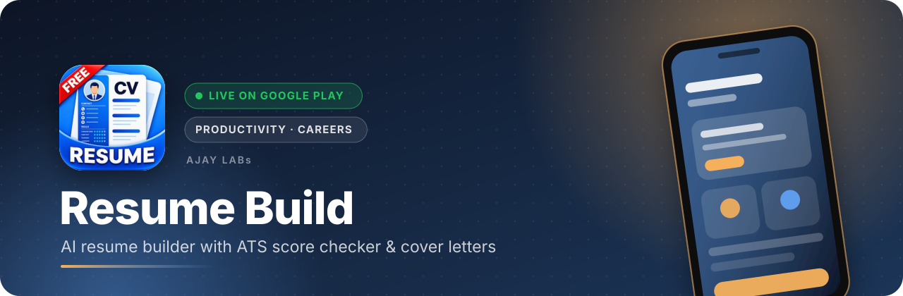

   

---

## ✨ Overview

Resume Builder is an all-in-one resume builder and CV maker for freshers and professionals. It combines a step-by-step builder, ATS-friendly templates, an **ATS score checker** for existing resumes, and **AI writing assistance** — then exports a print-ready A4 PDF in one tap.

## 🚀 Features

<table>
<tr>
<td width="50%" valign="top"><h3>📝 Step-by-step builder</h3>Personal details, education, experience, skills, certifications, projects</td>
<td width="50%" valign="top"><h3>🎯 ATS score checker</h3>Upload a PDF/DOCX resume → compatibility score, keywords, suggestions</td>
</tr>
<tr>
<td width="50%" valign="top"><h3>🎨 Templates</h3>Clean, executive, creative and ATS-friendly — switch without losing data</td>
<td width="50%" valign="top"><h3>🤖 AI writing assistant</h3>Polish summaries, action-verb bullets, tailor to a role</td>
</tr>
<tr>
<td width="50%" valign="top"><h3>✍️ Cover letter generator</h3>Matched to your resume template</td>
<td width="50%" valign="top"><h3>📤 A4 PDF export & share</h3>Email, WhatsApp, LinkedIn, Drive or device files</td>
</tr>
<tr>
<td width="50%" valign="top"><h3>☁️ Google sign-in & cloud sync</h3>Drafts saved locally or synced across devices</td>
<td width="50%" valign="top"><h3>📣 Ad-supported</h3>Banner + interstitial ads with cooldown and fail-safe loading</td>
</tr>
</table>

## 📱 Screenshots

  
  
  
   
  
  
  

## 🧱 Tech stack

  
  
  
  
  
  
  

## 🏗️ Architecture

## 🔍 Engineering highlights

- Parses uploaded **PDF and DOCX** resumes on-device for ATS scoring (Syncfusion PDF + archive)
- Pluggable AI layer over **Anthropic Claude** and **OpenRouter**
- Multiple resume templates rendered to print-ready A4 PDFs
- **67 automated tests** (AI resume flow, ad service, key screens); `flutter analyze` clean
- Targets **Android 16 (API 36)** with 16 KB page-size alignment verified
- Test ads gated to debug builds to avoid invalid-traffic policy strikes; regular versioned releases (2.3.x)

## 🔒 About this repository

This is a **product showcase**. The source code, credentials and signing keys are private. Happy to walk through the architecture and code in an interview — reach out below.

---

  Designed & built by <a href="https://github.com/theajay17"><b>Ajay Kumar Saw</b></a> · Wushang Labs  
  
  
  

